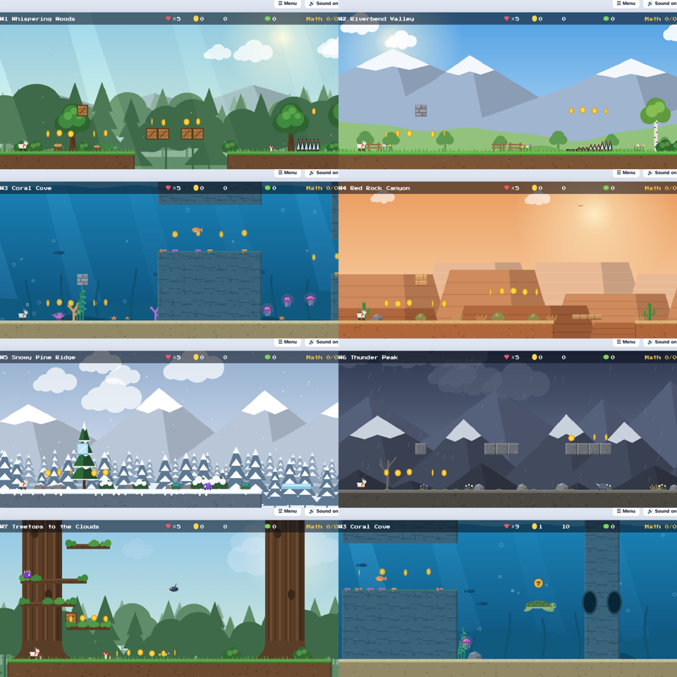
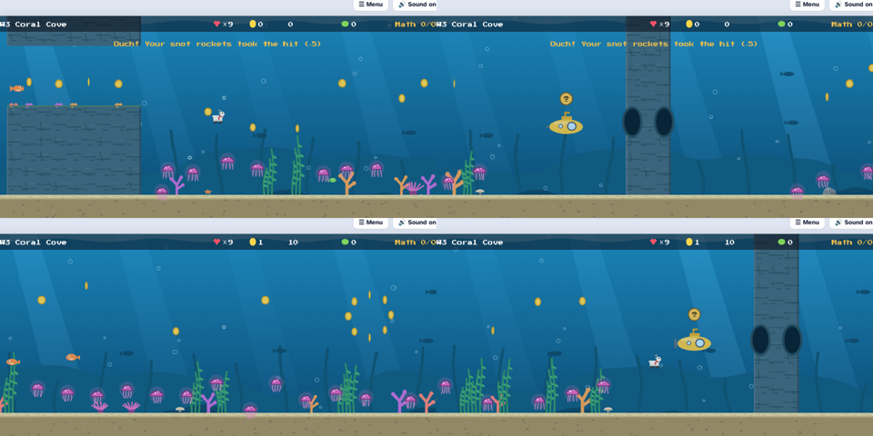

# Bramble’s Summit: SAT Algebra 2 Climb

A browser platformer where students guide Bramble the goat from the forest floor up to a castle in the clouds to rescue Professor Goat, by solving SAT-style Algebra 2 questions.

## Play

Open `index.html` in any modern browser. Nothing to install or build.

To share with students, turn on **GitHub Pages** (Settings → Pages → Deploy from branch `main`, folder `/root`), then share the link it gives you.

## What’s inside

- **Seven worlds:** Whispering Woods, Riverbend Valley, Coral Cove (underwater), Red Rock Canyon, Snowy Pine Ridge, Thunder Peak, and Treetops to the Clouds.
- **Coral Cove:** an underwater world. Tap jump to swim. Stinging jellyfish cover most of the sea floor and can’t be stomped or sneezed away. Swim through gaps in coral columns and along narrow rock tunnels.
- **Checkpoint rides:** two per world (hollow oak tunnel, zip line, raft, hot air balloon, submarine, giant sea turtle, mine cart, barrel cannon, cable car, basket lift). Students board a ride by answering a math question correctly.
- **Castles:** every castle has its own look and gets harder as you climb. They start with just lava pits and flame jets, then add cannons firing big cannonballs (jump over them or bounce on top), bridges that crumble under your feet, swinging axes and crushing stone blocks. The final castle uses all of them. After the hall comes a boss fight.
- **Final world:** climb a giant tree, then cross drifting, elevator and vanishing clouds.
- **Bricks:** jump into a brick from below to smash it and knock out any enemy standing on it.
- **Spikes:** they match each world (thorny brambles, red rock shards, ice spikes, quartz crystals) with dark outlines so they’re easy to see. Some pop up and down out of holes in the ground, so you have to time your crossing.
- **Bonus round:** 90 seconds of questions after each world earns slot machine spins.

## Math

Every ride, gate and castle door asks an SAT-style question from the Algebra 2 side of the test (mostly the **Advanced Math** domain). Questions are written in the style and format of the released digital SAT practice tests, but they are original items, not copies of College Board questions.

- **92 written questions** plus **36 question types that generate new numbers every time.**
- **Topics:** quadratics and vertex form, the discriminant, sums and products of roots, polynomial factors and the remainder theorem, polynomial identities, exponential equations, growth and decay models, exponent rules and rational exponents, rational and radical equations (including extraneous solutions), function notation and composition, transformations, nonlinear systems, systems with no or infinitely many solutions, absolute value equations, circles in the xy-plane, radians, arc length and right-triangle trig.
- **Two answer formats, like the real SAT:** four-choice multiple choice, and student-produced response where students type the answer (fractions like 7/2 or decimals like 3.5 both count).
- **Three levels:** Warm-up, Challenge and Brain-buster. Later worlds ask more Challenge and Brain-buster questions.
- Every answer comes with a worked explanation.

Questions a device has already seen are remembered in the browser so they don’t repeat.

